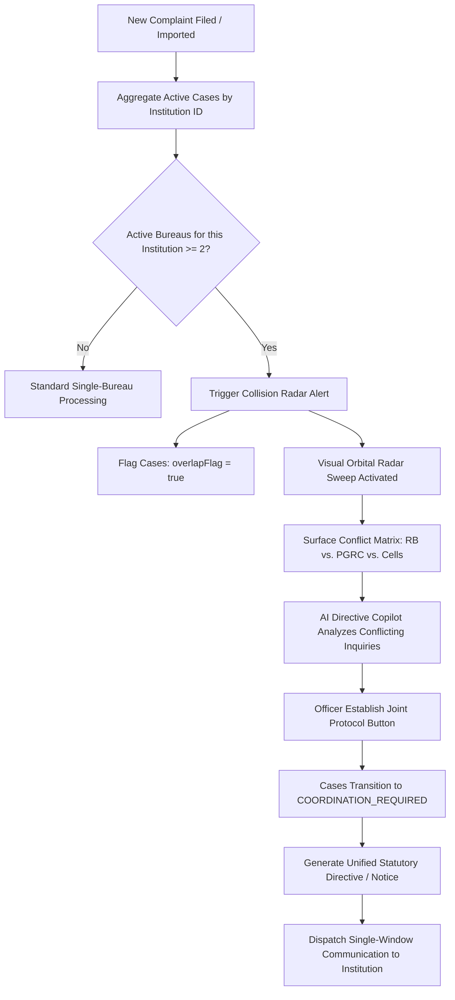
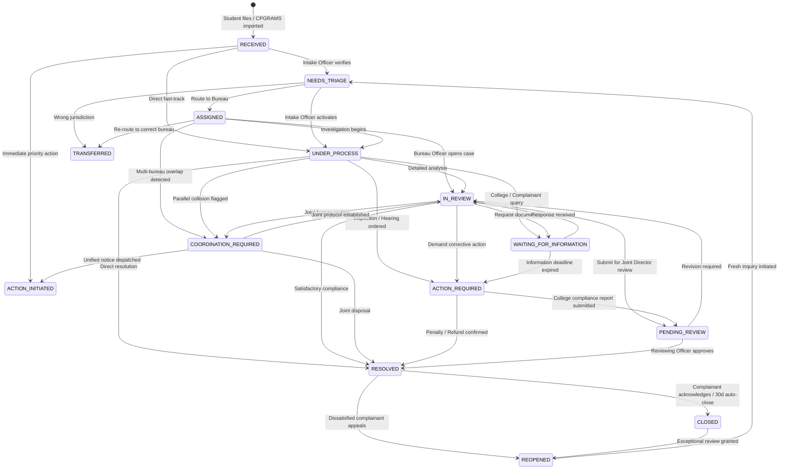
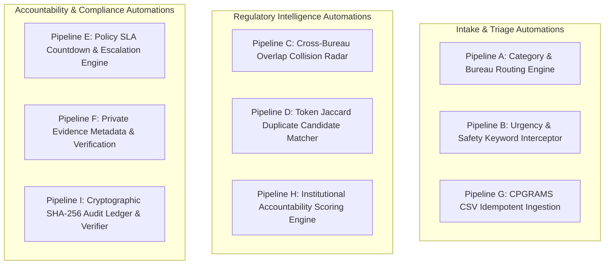
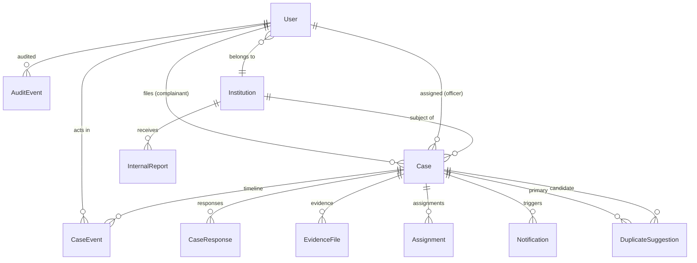

# S.U.G.A.M. 2.0 — Smart Unified Grievance & Accountability Matrix
## Official System Architecture, Implementation Report & Workflow Pipeline Specification

**Project:** S.U.G.A.M. 2.0 (Smart Unified Grievance & Accountability Matrix)  
**Hackathon / Problem Statement:** Smart India Hackathon (SIH 2026) · PS 26264 · AICTE Complaint & Accountability Dashboard  
**Status:** **FULLY IMPLEMENTED & OPERATIONAL MVP (V2.1)**  
**Target Authority:** All India Council for Technical Education (AICTE), Ministry of Education, Government of India  
**Architecture Paradigm:** Next.js 16 Unified Full-Stack Modular Monolith · Prisma ORM · Embedded Zero-Config SQLite / Enterprise MongoDB/Postgres Ready · SHA-256 Hash-Chained Audit Ledger  

---

## 1. Executive Summary & Implementation Evolution

### 1.1 What is S.U.G.A.M. 2.0?
S.U.G.A.M. is an **officer-first regulatory intelligence and institutional accountability platform** designed specifically to solve AICTE's multi-bureau grievance monitoring and tracking challenges.

Traditional complaint systems act merely as passive ticketing forms where complaints enter silos, causing:
1. **Parallel Inquiries & Inter-Bureau Collisions:** Regulation Bureau, Public Grievance Redressal Cell (PGRC), and Approval Bureau often issue uncoordinated, conflicting notices to the same college.
2. **Lack of Institutional Context:** Complaints are handled as isolated incidents rather than tracking the holistic compliance posture of an educational institution.
3. **Black-box Tracking for Complainants:** Students and faculty members receive generic statuses with no transparency on actions taken.
4. **Lack of Cryptographic Accountability:** Modifying, deleting, or losing complaint audit trails can happen without detection.

### 1.2 Evolution: Planned vs. Implemented Architecture
The table below documents the strategic engineering evolution from the initial planning document to the production MVP:

| Aspect | Initial Proposed Plan | Fully Implemented Reality (SUGAM-MVP) | Engineering Justification & Impact |
|---|---|---|---|
| **Architecture** | Split Next.js frontend + NestJS backend microservice | **Unified Next.js 16 Full-Stack Architecture** with `/api/v1/*` App Router handlers | Eliminates dual-deployment network latency, removes CORS friction, enables single-command startup (`npm run dev`), simplifies hosting. |
| **Database** | MongoDB Atlas required | **Prisma 6.11 with SQLite (`db/custom.db`) + 1:1 MongoDB/PostgreSQL Migration Ready** | Zero-setup, instant offline execution for hackathon judging with zero database server dependencies, while retaining enterprise schema compatibility. |
| **SIH PS 26264 Core Feature** | Generic duplicate candidate list | **Multi-Bureau Collision Radar & Inter-Bureau Coordination Engine** (`collision-radar-visualizer.tsx`) | Specifically solves PS 26264: detects when Regulation Bureau & PGRC concurrently investigate the same institution, providing an interactive Radar Canvas and 4-step simulation. |
| **AI Integration** | Future external API | **AI Directive Copilot & Harmonizer** (`ai-directive-copilot.tsx`) | Built-in explainable intelligence for multi-bureau directive synthesis, 30-day statutory SLA timeline analysis, and root cause diagnosis without API latency bottlenecks. |
| **Design Standard** | Standard Tailwind dashboard | **UIDAI & Digital India Standard Compliance** (`uidai-header.tsx`, `uidai-service-grid.tsx`, `uidai-footer.tsx`) | National emblem, Ashoka Lion Capital, Indian Flag badge, Ministry of Education branding, Central Grid live telemetry pulse, and tricolor accent bar. |
| **Multilingual Support** | English only (Phase 3 idea) | **100% Bilingual Support (English & Hindi)** with session persistence (`src/lib/i18n.ts`) | Comprehensive translation across all 7 portals, UI badges, status chips, bureau names, and error feedback. |
| **Portals & Navigation** | Role-gated single screen | **Dual Dedicated Experiences:** (1) Public Citizen & Student Portal + (2) AICTE Central Command Center (HQ) | Clear separation of concerns: public users get a friendly, transparent tracking interface while officers get an executive high-command cockpit. |
| **Audit Security** | Proposed SHA-256 chain | **Fully Functional SHA-256 Hash Chain with 1-Click Verifier** (`src/lib/audit.ts`) | Sequential cryptographic linking (`GENESIS` → Event 1 → Event 2) with instant sequence gap and payload tamper detection. |
| **Automations** | Conceptual rules | **9 Explainable Automated Pipelines** with human-in-the-loop overrides | Every suggestion outputs confidence score, rule terms, and human explanation ("why this fired"). Never auto-rejects or silently merges cases. |

---

## 2. System Architecture & Tech Stack

```mermaid
flowchart TB
    subgraph CLIENT[Dual Role-Centric Client Surfaces]
      ST[Citizen & Student Portal\n(public-portal.tsx)]
      CW[College Workspace\n(college.tsx)]
      HQ[AICTE Central Command Center\n(aicte-command-center.tsx)]
      AU[Auditor Integrity Console\n(auditor.tsx)]
      AD[Platform Admin Cockpit\n(admin.tsx)]
    end

    subgraph ENGINE[Next.js 16 Full-Stack Engine (App Router)]
      UI[Shared UI Shell & Government Design System]
      I18N[Bilingual Engine (English / Hindi)]
      AUTH_G[Session Guard & Server-Side RBAC]
      
      subgraph REST_API[34 High-Performance REST Endpoints /api/v1/*]
        API_AUTH[/auth - Login, Me, Logout/]
        API_CASES[/cases - CRUD, Assign, Events, Responses, Evidence, Overlaps/]
        API_DASH[/dashboard - Live Summary & Workload Aggregations/]
        API_INST[/institutions - Registry, 360 Profile, Scores/]
        API_AUDIT[/audit - Cryptographic Trail & Chain Verifier/]
        API_ADMIN[/admin - Users, Templates, Reports, Simulation/]
      end

      subgraph AUTOMATION_PIPELINES[Explainable Automation Core]
        AUTO_ROUTING[Intake & Rule-Based Bureau Routing]
        AUTO_URGENCY[Urgency & Ragging/Safety Interceptor]
        AUTO_RADAR[Multi-Bureau Collision Radar (PS 26264)]
        AUTO_DUP[Token Jaccard Duplicate Candidate Engine]
        AUTO_SLA[Dynamic SLA & Overdue Monitor]
        AUTO_SCORE[Institutional Accountability Algorithm]
      end
    end

    subgraph STORAGE[Persistence & Storage Layer]
      PRISMA[Prisma ORM Client]
      SQLITE[(SQLite db/custom.db\nZero-Config Local)]
      PG_MONGO[(MongoDB / PostgreSQL\nProduction Target)]
      FILES[(Private Uploads Storage)]
    end

    CLIENT --> UI
    UI --> I18N
    UI --> AUTH_G
    AUTH_G --> REST_API
    REST_API --> AUTOMATION_PIPELINES
    REST_API --> PRISMA
    AUTOMATION_PIPELINES --> PRISMA
    PRISMA --> SQLITE
    PRISMA -. Production Driver .-> PG_MONGO
    REST_API --> FILES
```

### 2.1 Technology Stack Matrix
* **Frontend Framework:** Next.js 16.1.1 (App Router), React 19.0.0, TypeScript 5.
* **Styling & Components:** Tailwind CSS v4, Lucide React (v0.525), Radix UI primitives, Framer Motion (v12.23), Recharts (v2.15).
* **Database & ORM:** Prisma ORM 6.11.1, SQLite 3 (`db/custom.db`) with zero external service dependencies; schema designed for 1:1 MongoDB/PostgreSQL transfer.
* **Authentication & Authorization:** Secure HttpOnly cookie-based session management (`sugam_token`), Argon2 / PBKDF2 SHA-256 password hashing, brute-force rate limiter (30 attempts/minute per IP).
* **Security & Integrity:** Cryptographic SHA-256 sequential audit ledger, strict server-side RBAC on every route, data masking on institutional projections.
* **Testing & Quality Assurance:** Custom end-to-end multi-role route validation script (`scripts/smoke_all_routes.mjs`), ESLint 9 (0 errors, 0 warnings).

---

## 3. The 7 Role Portals & Access Control Matrix

S.U.G.A.M. enforces **Zero Trust Server-Side RBAC** (`src/lib/cases.ts`, `src/lib/apih.ts`). Hiding UI elements is never treated as authorization; every API route independently checks role permissions and institutional scope.

| Role Code | User Title | Demo Account | Landing Experience | Permitted Capabilities | Strict Constraints / Prohibitions |
|---|---|---|---|---|---|
| `COMPLAINANT` | Student / Faculty | `student@sugam.demo`<br/>`faculty@sugam.demo`<br/>`student2@sugam.demo` | **Public Citizen Portal** (`public-portal.tsx`) | Submit grievances, track URN status, view own action history, upload proof, rate resolved grievances. | **Cannot** view internal officer notes, other citizens' complaints, or institutional backend metrics. |
| `INSTITUTION_OFFICER` | College Nodal Officer | `college@sugam.demo` | **College Workspace** (`college.tsx`) | View cases assigned to their verified institution, submit official replies using templates, upload evidence, acknowledge internal reports. | **Identity Masking:** Never receives complainant roll numbers, personal contact details, or data from other colleges. |
| `INTAKE_OFFICER` | Intake / Registry Officer | `intake@sugam.demo` | **Intake Dashboard & Queue** (`officer.tsx`) | Validate incoming grievances, review automated category/bureau suggestions, triage cases, run simulated CPGRAMS CSV imports. | **Cannot** legally dispose, dismiss, or make final closure orders. |
| `BUREAU_OFFICER` | Bureau Officer (RB, PGRC, etc.) | `bureau@sugam.demo`<br/>`rb@sugam.demo`<br/>`pgrc@sugam.demo` | **Bureau Work Queue** (`officer.tsx`) | Process assigned cases, execute state transitions, request college responses, initiate inter-bureau coordination, set next actions. | Scope restricted to their assigned Bureau / assigned cases. Cannot alter audit logs. |
| `REVIEWING_OFFICER` | Reviewing Officer / Joint Director | `reviewer@sugam.demo` | **Cross-Bureau Command Center** (`aicte-command-center.tsx`) | Supervise cross-bureau cases, review SLA escalations, approve closures, initiate joint regulatory directives, review audit trails. | Restricted by audit logging on every administrative review. |
| `AUDITOR` | Compliance / Vigilance Auditor | `auditor@sugam.demo` | **Audit & Integrity Console** (`auditor.tsx`) | Read full cryptographic audit ledger, run 1-click SHA-256 hash verification, inspect sequence gaps and metadata tampering. | **Strictly Read-Only:** Cannot mutate, update, or delete any case or audit event. |
| `PLATFORM_ADMIN` | System Administrator | `admin@sugam.demo` | **Administration Cockpit** (`admin.tsx`) | Manage demo users/roles, edit reply templates, trigger SLA escalation jobs, view integration status, execute demo resets. | Does not bypass judicial / audit separation. |

---

## 4. Problem Statement 26264 Core Innovations: Multi-Bureau Overlaps & Coordination

The defining innovation of S.U.G.A.M. 2.0 is resolving **PS 26264**: *AICTE Complaint Dashboard — Addressing parallel, conflicting complaint proceedings across specialized AICTE Bureaus*.

### 4.1 The Inter-Bureau Collision Problem
In AICTE operations, a single institution often receives complaints routed to different offices:
* **Regulation Bureau (RB):** Investigating illegal capitation fees, unauthorized course intake, or infrastructure norm violations.
* **Public Grievance Redressal Cell (PGRC):** Investigating student harassment, hostel deficiencies, or fee refund delays.
* **Approval Bureau (AB):** Processing Extension of Approval (EoA) documents.

When these bureaus act independently without visibility, they issue contradictory notices, set overlapping deadlines, and duplicate administrative efforts.

### 4.2 Multi-Bureau Collision Radar (`collision-radar-visualizer.tsx`)
The Collision Radar Visualizer provides real-time detection and visualization of multi-bureau collisions:



### 4.3 Interactive Features of the Collision Visualizer
1. **Topological Radar Canvas:** Interactive visual radar featuring orbital rings, bureau nodes, radar sweep animations, and pulse signals highlighting institutions under concurrent scrutiny.
2. **Conflict Matrix View:** Compares competing bureaus, active Case IDs, conflicting investigation mandates, and assigned officers side-by-side.
3. **4-Step Simulation Engine:** A built-in live simulation engine demonstrating:
   * *Step 1: Ingestion* — Multiple grievances registered from different sources.
   * *Step 2: Detection* — Radar identifies cross-bureau intersection for Institution `AICTE-1042`.
   * *Step 3: Harmonization* — AI Copilot synthesizes conflicting demands into a unified action plan.
   * *Step 4: Joint Order* — Dispatches a unified notice under AICTE Act Section 10(k).
4. **AI Directive Copilot (`ai-directive-copilot.tsx`):**
   * *Harmonized Directive Synthesis:* Generates a consolidated communication to the college covering both regulatory non-compliance and student welfare.
   * *Statutory 30-Day SLA Timeline:* Coordinates multi-department evidence collection into a synchronized deadline.
   * *Systemic Root Cause Analysis:* Diagnoses whether multiple grievances indicate deeper systemic governance failures within the college.
5. **Official Directive Modal (`official-directive-modal.tsx`):**
   * Produces an authentic, printable Government of India letterhead notice complete with file reference (`F. No. AICTE/RB-PGRC/COORD/2026/0842`), legal citation under AICTE Act 1987 Section 10(k), and signature blocks.

---

## 5. The 10+ State Workflow Machine & Transition Rules

S.U.G.A.M. implements an expanded **14-state deterministic finite state machine** (`src/lib/constants.ts`). Transitions are strictly guarded on the server; illegal transitions return `400 Bad Request` with an explanation of permitted next states.



### Transition Permission & Validation Table
| Current Status | Allowed Target Statuses | Authorized Roles | Mandatory Reason Required? |
|---|---|---|---|
| `RECEIVED` | `NEEDS_TRIAGE`, `UNDER_PROCESS`, `ACTION_INITIATED` | Intake Officer, Bureau Officer, Reviewing Officer | No |
| `NEEDS_TRIAGE` | `ASSIGNED`, `UNDER_PROCESS`, `ACTION_INITIATED`, `TRANSFERRED` | Intake Officer, Bureau Officer, Reviewing Officer | No |
| `ASSIGNED` | `IN_REVIEW`, `UNDER_PROCESS`, `ACTION_INITIATED`, `COORDINATION_REQUIRED`, `TRANSFERRED`, `NEEDS_TRIAGE` | Intake Officer, Bureau Officer, Reviewing Officer | No |
| `UNDER_PROCESS` | `IN_REVIEW`, `COORDINATION_REQUIRED`, `WAITING_FOR_INFORMATION`, `ACTION_REQUIRED`, `RESOLVED`, `TRANSFERRED` | Bureau Officer, Reviewing Officer | No |
| `IN_REVIEW` | `WAITING_FOR_INFORMATION`, `ACTION_REQUIRED`, `COORDINATION_REQUIRED`, `PENDING_REVIEW`, `RESOLVED`, `TRANSFERRED` | Bureau Officer, Reviewing Officer | **Yes** (`reason` required) |
| `COORDINATION_REQUIRED` | `IN_REVIEW`, `ACTION_INITIATED`, `UNDER_PROCESS`, `RESOLVED`, `TRANSFERRED` | Bureau Officer, Reviewing Officer | **Yes** (`reason` required) |
| `WAITING_FOR_INFORMATION` | `IN_REVIEW`, `UNDER_PROCESS`, `ACTION_REQUIRED` | Bureau Officer, Reviewing Officer | **Yes** (`reason` required) |
| `ACTION_REQUIRED` | `PENDING_REVIEW`, `IN_REVIEW`, `RESOLVED` | Bureau Officer, Reviewing Officer | **Yes** (`reason` required) |
| `PENDING_REVIEW` | `RESOLVED`, `IN_REVIEW` | Bureau Officer, Reviewing Officer | **Yes** (`reason` required) |
| `TRANSFERRED` | `ASSIGNED`, `UNDER_PROCESS`, `IN_REVIEW` | Intake Officer, Reviewing Officer | **Yes** (`reason` required) |
| `RESOLVED` | `CLOSED`, `REOPENED` | Reviewing Officer | **Yes** (`reason` required) |
| `CLOSED` | `REOPENED` | Reviewing Officer | **Yes** (`reason` required) |
| `REOPENED` | `NEEDS_TRIAGE`, `IN_REVIEW`, `UNDER_PROCESS` | Intake Officer, Bureau Officer, Reviewing Officer | **Yes** (`reason` required) |

---

## 6. Comprehensive Automation Pipelines

S.U.G.A.M. 2.0 embeds **9 explainable automation pipelines** (`src/lib/automation.ts`, `src/lib/audit.ts`, `src/lib/notify.ts`). In accordance with government accountability principles:
* **AI & Rules Suggest — Humans Decide:** No automation auto-rejects a citizen grievance or applies legal sanctions autonomously.
* **Explainable Automation:** Every automated suggestion outputs a human-readable reason tag visible in the interface.



### 6.1 Pipeline A: Intake & Explainable Bureau Routing
* **Logic:** Scans complaint subject and description against a curated institutional dictionary covering 12 grievance categories and 8 specialized AICTE bureaus.
* **Formula:** Confidence score = $\min(0.95, 0.55 + \text{hits} \times 0.15)$.
* **Output:** Category suggestion, assigned bureau, confidence percentage, and an explanation string such as:  
  *`"Matched terms ['caution deposit', 'fee refund'] → FEE_REFUND routed to Regulation Bureau. Officer can override."`*

### 6.2 Pipeline B: Urgency & High-Risk Interceptor
* **Logic:** Real-time scanning for critical safety keywords (`"ragging"`, `"assault"`, `"threat to life"`, `"suicide"`, `"violence"`).
* **Action:** Immediately flags case priority to `CRITICAL` and sets a statutory 24-hour SLA deadline (`slaDaysByPriority: { CRITICAL: 1 }`).
* **Safety Invariant:** A human officer must review the emergency flag; it does not dispatch automated law-enforcement requests.

### 6.3 Pipeline C: Cross-Bureau Overlap Collision Detection (PS 26264)
* **Logic:** Evaluates active cases grouped by `institutionId`. When an institution has cases concurrently open across $\ge 2$ different bureaus (e.g. Regulation Bureau + PGRC):
* **Action:** Generates an `OverlapResult`, triggers the Collision Radar visual banner, marks `overlapFlag = true`, and enables the one-click Joint Protocol coordination workflow.

### 6.4 Pipeline D: Explainable Duplicate Candidate Matching
* **Logic:** Runs candidate comparison between cases targeting the same institution using tokenization, stop-word elimination, and Jaccard token similarity:
  $$J(A, B) = \frac{|A \cap B|}{|A \cup B|}$$
* **Threshold:** Set to $0.32$. Cases exceeding this threshold generate a `DuplicateSuggestion` record.
* **Human-in-the-Loop:** Officers must explicitly review, compare side-by-side, and click "Confirm Relationship" or "Reject". Cases are **linked**, never destructively merged or deleted.

### 6.5 Pipeline E: SLA Monitoring, Due-Soon Alerts & Escalation
* **Logic:** Calculates `dueAt` based on configurable demo policy (`DEMO-POLICY-v1`):
  * `CRITICAL`: 1 day (24 hours)
  * `HIGH`: 3 days
  * `NORMAL`: 15 days
  * `LOW`: 20 days
* **Monitoring:** Dynamic checks identify cases `Due Soon` ($\le 3$ days remaining) or `Overdue` ($\le 0$ ms). Triggers in-app notifications with unread badges to assigned officers.
* **Escalation:** Overdue cases automatically flag `slaBreached = true` and `escalated = true`, pushing them into the Reviewing Officer's Priority Queue.

### 6.6 Pipeline F: Evidence Metadata & Private File Storage
* **Logic:** Uploaded attachments (receipts, marksheets, correspondence) undergo strict MIME-type and file-size validation ($\le 10$ MB).
* **Storage:** Raw binaries reside in private storage (`private-uploads/`); only typed metadata (`EvidenceFile` with `storageKey`, `accessLevel`, `verificationState`) is saved in the database.
* **Privacy:** College officers cannot access complainant-only confidential documents.

### 6.7 Pipeline G: Simulated CPGRAMS / External Ingestion with Idempotency
* **Logic:** Accepts CSV / JSON external imports. Enforces compound uniqueness on `[sourceSystem, sourceRecordId]`.
* **Idempotency:** Re-running an identical sync run reports duplicate rows as skipped without creating duplicate records.
* **Rejection Reporting:** Malformed rows are returned in a rejected row log explaining field validation failures row-by-row.

### 6.8 Pipeline H: Institution 360° & Accountability Scoring
* **Objective:** Computes an objective institutional compliance score ($0 - 100$) for every college based on actual historical data.
* **Disclosed Mathematical Formula:**
  $$\text{Score} = (\text{Speed Score} \times 0.40) + (\text{SLA Compliance} \times 0.35) + (\text{Complainant Feedback} \times 0.25)$$
  * *Speed Score (40%):* Calculated from average days to resolution: $\max(0, \min(100, 100 - (\text{avgDays} - 2) \times 8))$.
  * *SLA Compliance (35%):* Percentage of cases resolved without SLA breach: $(\frac{\text{On-Time Resolved}}{\text{Total Resolved}}) \times 100$.
  * *Complainant Feedback (25%):* Derived from 1–5 star ratings submitted by complainants upon resolution.
* **Bands:** $\ge 70$ (GREEN - High Compliance), $50 - 69$ (AMBER - Under Monitoring), $< 50$ (RED - Regulatory Scrutiny).

### 6.9 Pipeline I: SHA-256 Cryptographic Hash-Chained Audit Trail
* **Design:** Every significant transaction (complaint creation, assignment, transition, note, evidence, coordination, resolution) writes to `AuditEvent`.
* **Hash Formula:** Each event's hash is computed over canonical JSON serialization including sequence number, timestamp, actor ID, action, target ID, metadata, and the **previous event's hash**:
  $$\text{Hash}_n = \text{SHA-256}(\text{Canonical}(\text{Seq}_n, \text{Action}_n, \text{Actor}_n, \text{Target}_n, \text{PrevHash}_{n-1}, \text{Timestamp}_n))$$
  The genesis event uses `previousHash = "GENESIS"`.
* **One-Click Verifier (`verifyChain()`):** Iterates through the entire chain recalculating hashes. If any sequence gap occurs, or if any database administrator tampers with an event payload, the verifier identifies the exact sequence number and failure reason.

---

## 7. Prisma Database Schema & Data Models

The data model (`prisma/schema.prisma`) represents the complete domain model with 15 typed entities:



### Complete Schema Summary Table
| Model Name | Description & Key Fields | Indexes & Constraints |
|---|---|---|
| `User` | Authenticated actors (`id`, `name`, `email`, `passwordHash`, `primaryRole`, `rolesJson`, `rollNo`, `designation`, `bureau`, `institutionId`). | `@unique(email)` |
| `Institution` | Approved colleges (`id`, `code`, `permanentId`, `name`, `state`, `district`, `region`, `approvalStatus`, `identifiersJson`). | `@unique(code)` |
| `Case` | Core grievance entity (`id`, `caseNumber`, `sourceSystem`, `sourceRecordId`, `institutionId`, `category`, `bureau`, `status`, `priority`, `dueAt`, `overlapFlag`, `coordinationStatus`). | `@unique(caseNumber)`<br/>`@@unique([sourceSystem, sourceRecordId])`<br/>`@@index([institutionId, status])` |
| `CaseEvent` | Chronological case timeline (`id`, `caseId`, `actorId`, `eventType`, `summary`, `visibility`, `requestId`, `createdAt`). | `@@index([caseId, createdAt])` |
| `AuditEvent` | SHA-256 hash-chained immutable ledger (`id`, `sequence`, `actorEmail`, `action`, `targetType`, `targetId`, `previousHash`, `eventHash`). | `@unique(sequence)`<br/>`@@index([targetType, targetId])` |
| `Assignment` | Department/officer re-assignment history (`id`, `caseId`, `fromBureau`, `toBureau`, `fromOfficerId`, `toOfficerId`, `reason`). | `@@index([caseId, createdAt])` |
| `EvidenceFile` | Private attachment metadata (`id`, `caseId`, `storageKey`, `originalFileName`, `mimeType`, `sizeBytes`, `accessLevel`, `verificationState`). | `@@index([caseId])` |
| `CaseResponse` | Official replies from colleges/citizens (`id`, `caseId`, `authorRole`, `message`, `templateUsed`, `evidenceIdsJson`). | `@@index([caseId, createdAt])` |
| `Notification` | In-app alerts (`id`, `recipientId`, `caseId`, `type`, `title`, `message`, `readAt`). | `@@index([recipientId, createdAt])` |
| `DuplicateSuggestion` | Algorithm candidate pairs (`id`, `primaryCaseId`, `candidateCaseId`, `score`, `algorithmVersion`, `reasonsJson`, `state`). | `@@index([state])` |
| `PolicyConfig` | Dynamic SLA and routing rules (`id`, `key`, `valueJson`). | `@unique(key)` |
| `IntegrationSyncRun` | External connector audit (`id`, `sourceSystem`, `totalRows`, `importedRows`, `duplicateSkipped`, `rejectedRowsJson`). | — |
| `Counter` | Atomic sequence generator for Case IDs (`id`, `key`, `value`). | `@unique(key)` |
| `InternalReport` | Officer-to-institution notices (`id`, `institutionId`, `caseId`, `subject`, `message`, `status`). | — |
| `ReplyTemplate` | Pre-approved college reply formats (`id`, `title`, `category`, `body`). | — |

---

## 8. REST API Catalogue (All 34 Endpoints)

Every endpoint is hosted under `/api/v1/` and returns standard JSON envelopes: `{ success: true, data: { ... } }` or `{ success: false, error: { message, fieldErrors? } }`.

### 8.1 Authentication & Profile
* `POST /api/v1/auth/login` — Authenticate credentials; sets HttpOnly cookie `sugam_token`. Rate-limited.
* `POST /api/v1/auth/logout` — Destroys session cookie.
* `GET /api/v1/auth/me` — Returns current user identity, roles, institution, and permissions.

### 8.2 Dashboard & Analytics
* `GET /api/v1/dashboard/summary` — Role-scoped executive KPIs (total, open, due-soon, overdue, critical, overlap counts, ageing buckets).
* `GET /api/v1/dashboard/workload` — Aggregates workload distribution by AICTE bureau, region, and ageing spectrum.

### 8.3 Cases & Core Workflow
* `GET /api/v1/cases` — Paginated, searchable, role-scoped case register with allowlisted filters (`q`, `status`, `bureau`, `region`, `priority`, `source`, `due`, `overlapOnly`).
* `POST /api/v1/cases` — Submit a grievance. Auto-generates Case ID, computes initial routing, runs urgency check, creates initial case/audit events.
* `GET /api/v1/cases/[id]` — Returns role-projected case details, masked complainant data (if college), timeline, responses, evidence, and suggestions.
* `PATCH /api/v1/cases/[id]` — Execute validated status transition, update next action, or edit case fields.
* `POST /api/v1/cases/[id]/assign` — Assign or reassign case to another bureau or officer with recorded justification.
* `GET /api/v1/cases/[id]/events` — Retrieve visible timeline events according to role permission.
* `POST /api/v1/cases/[id]/events` — Append an official note or case event.
* `POST /api/v1/cases/[id]/responses` — Submit an institution response (with optional template) or complainant follow-up.
* `POST /api/v1/cases/[id]/evidence` — Upload and attach validated supporting evidence file.
* `POST /api/v1/cases/[id]/rate` — Complainant 1–5 star rating and feedback upon resolution.
* `GET /api/v1/cases/[id]/duplicates` — Retrieve duplicate candidates evaluated by the token similarity engine.

### 8.4 Cross-Bureau Overlaps (PS 26264 Innovation)
* `GET /api/v1/cases/overlaps` — Identifies all institutions facing concurrent complaints across multiple AICTE bureaus.
* `POST /api/v1/cases/overlaps` — Establishes Inter-Bureau Joint Protocol, setting status to `COORDINATION_REQUIRED` and writing audit logs.

### 8.5 Institutions Registry & 360°
* `GET /api/v1/institutions` — Search and paginate AICTE-approved institutions with AISHE and Permanent IDs.
* `POST /api/v1/institutions` — Register a new institution (Authorized staff only).
* `GET /api/v1/institutions/[id]` — Complete Institution 360° profile, including historical cases, compliance rating, and notices.

### 8.6 Audit & Integrity
* `GET /api/v1/audit/events` — Paginated audit log inspection for Auditor and Reviewing Officer.
* `POST /api/v1/audit/verify` — Recomputes SHA-256 hash chain and returns cryptographic validity verification.

### 8.7 Administration, Imports & Integrations
* `GET /api/v1/admin/users` — Manage platform demo users and role assignments.
* `POST /api/v1/admin/users` — Create/update demo user.
* `GET /api/v1/admin/templates` — Fetch pre-defined response templates.
* `POST /api/v1/admin/templates` — Create response template.
* `GET /api/v1/admin/reports` — View internal officer-to-college reports.
* `POST /api/v1/admin/reports` — Dispatch formal internal inquiry report.
* `GET /api/v1/admin/scores` — View institution accountability ranking breakdown.
* `POST /api/v1/imports/csv` — Idempotent CPGRAMS CSV import with per-row validation and rejection reports.
* `GET /api/v1/imports/runs` — History of past synchronization runs.
* `GET /api/v1/integrations/status` — Health and telemetry of simulated connectors.
* `GET /api/v1/notifications` — Retrieve user's in-app notifications and unread badge count.
* `POST /api/v1/notifications/[id]/read` — Mark notification as read.
* `POST /api/v1/demo/reset` — Reset database to pristine seed state (Demo mode only).
* `POST /api/v1/demo/trigger-checks` — Manually trigger SLA countdown and deadline escalation check.
* `GET /api/v1/health` — System telemetry and database connectivity check.

---

## 9. Frontend Architecture & Component Directory Map

The frontend components (`src/components/sugam/`) are organized into specialized modular units:

```text
src/
├── app/
│   ├── api/v1/...                 # 34 modular Next.js REST API routes
│   ├── globals.css                # Tailwind v4 theme, saffron/navy tokens, tricolor bar
│   ├── layout.tsx                 # Root HTML shell with Inter & JetBrains Mono typography
│   └── page.tsx                   # Master router: error boundary, auth guard, dual portal switch
├── components/
│   └── sugam/
│       ├── aicte-command-center.tsx       # AICTE HQ Cockpit: Tabs for Cases, Overlaps, Inst, Analytics
│       ├── public-portal.tsx             # Public Citizen Portal: Grievance Form, URN Tracking, History
│       ├── collision-radar-visualizer.tsx# PS 26264 Multi-Bureau Radar, Matrix & Simulation
│       ├── ai-directive-copilot.tsx      # Directive Harmonizer, 30d SLA & Root Cause AI
│       ├── official-directive-modal.tsx  # Printable AICTE Official Show-Cause Letterhead
│       ├── complaint-detail.tsx          # 14-State Transition Panel, Timeline, Evidence, Responses
│       ├── institutions.tsx              # Institution 360° Profile & 3-Pillar Accountability Score
│       ├── overlaps.tsx                  # Dedicated Cross-Bureau Overlap Table & Coordination Form
│       ├── auth-screen.tsx               # Login with 1-click Role Chip autofills and rate limiting
│       ├── student.tsx                   # Complainant workspace (legacy module maintained)
│       ├── college.tsx                   # College Nodal Officer workspace with masked complainant view
│       ├── officer.tsx                   # Bureau Officer My Work and Intake Queue
│       ├── admin.tsx                     # System administration, simulation controls, template manager
│       ├── auditor.tsx                   # SHA-256 Hash Chain verification and event search
│       ├── notifications.tsx             # Popover notification center with unread badges
│       ├── uidai-header.tsx              # National Emblem, Tricolor strip, Indian Flag, bilingual toggle
│       ├── uidai-service-grid.tsx        # Digital India service cards for filing, tracking, radar
│       ├── uidai-footer.tsx              # Official GoI accessibility and copyright footer
│       ├── google-stitch-bridge.tsx      # Google Labs Stitch Design Token & Blueprint Bridge
│       └── ui-bits.tsx                   # Reusable badges, cards, spinners, empty states
├── lib/
│   ├── apih.ts                    # Server API response helpers (ok, err, requireSession, paging)
│   ├── audit.ts                   # Cryptographic SHA-256 hash chaining and verifyChain() engine
│   ├── auth.ts                    # Password hashing (Argon2/PBKDF2), session cookies, rate limiting
│   ├── automation.ts              # Category rules, urgency terms, Jaccard similarity, scoring, overlaps
│   ├── cases.ts                   # Role-based query scoping and field projection masking
│   ├── client.ts                  # Typed client fetch wrapper with automatic 401 handling
│   ├── constants.ts               # Domain enums, labels, permitted transitions, demo policy
│   ├── db.ts                      # Prisma client singleton
│   ├── i18n.ts                    # Full English/Hindi translation dictionaries
│   ├── notify.ts                  # In-app notification dispatcher
│   ├── seed.ts                    # Deterministic synthetic seed data for all roles and scenarios
│   └── types.ts                   # Shared TypeScript interfaces
```

---

## 10. Verification, Testing & Demo Script

### 10.1 Running the Automated Smoke Test
The codebase includes an automated API route smoke test checking all 9 demo credentials across 16 core endpoints:

```bash
# Terminal 1: Run dev server
npm run dev

# Terminal 2: Execute automated route verification
npm run smoke:test
```
**Expected Result:** `✔ ALL ROUTE CHECKS PASSED (0 bugs found)`.

### 10.2 Ready Demo Accounts (Password: `demo123` for all)
* **Student:** `student@sugam.demo` (Files complaints, tracks live updates)
* **Faculty:** `faculty@sugam.demo` (Faculty salary grievance flow)
* **College Officer:** `college@sugam.demo` (Sunrise Institute nodal officer)
* **Intake Officer:** `intake@sugam.demo` (Intake queue & CPGRAMS import)
* **Regulation Bureau:** `rb@sugam.demo` (Regulatory violations & capitation fees)
* **PGRC Officer:** `pgrc@sugam.demo` (Student grievances & harassment)
* **Reviewing Officer:** `reviewer@sugam.demo` (Joint Director cross-bureau review)
* **Auditor:** `auditor@sugam.demo` (Cryptographic integrity check)
* **Platform Admin:** `admin@sugam.demo` (System controls & SLA simulation)

### 10.3 5-Minute Judge Demo Workflow
1. **Public Grievance Lodging (Student):**
   * Sign in as `student@sugam.demo`.
   * Open the **Public Citizen Portal**. Enter a complaint for *Sunrise Institute of Technology*.
   * Watch the real-time routing preview assign the case to the Regulation Bureau. Submit and receive a Case ID (e.g. `SUGAM-2026-0005`).
2. **AICTE Central Command Center & Collision Radar (Reviewing Officer):**
   * Click **"Switch to AICTE HQ"** in the top bar to seamlessly transition to the executive view.
   * Highlight the red **Multi-Bureau Overlap Alert** on the dashboard.
   * Open the **Collision Radar Visualizer**: demonstrate the Topological Radar Canvas and start the **4-Step Simulation Engine** to show how S.U.G.A.M. detects concurrent inquiries against the same college.
   * Click **"AI Directive Copilot"** to show automated multi-bureau harmonization.
   * Click **"Preview Official Notice"** to display the formal AICTE Section 10(k) directive.
   * Click **"Establish Joint Protocol"** to transition cases to `COORDINATION_REQUIRED`.
3. **Institutional Accountability 360° (College Context):**
   * Switch to the **Institutions** tab. Open *Sunrise Institute of Technology (AICTE-1042)*.
   * Show the 3-pillar **Accountability Score (82% GREEN)** with Speed (40%), SLA (35%), and Feedback (25%) broken down mathematically.
4. **College Response Loop:**
   * Sign in as `college@sugam.demo`.
   * Show that complainant personal details are **masked** (`Complaint ID: Protected`).
   * Select a pre-approved template (*"Fee refund acknowledgment"*), attach supporting metadata, and submit.
5. **Cryptographic Audit Verification (Auditor):**
   * Sign in as `auditor@sugam.demo`.
   * Open the **Audit & Integrity Console**.
   * Click **"Verify Hash Chain Integrity"**.
   * Show the SHA-256 mathematical proof verifying all events from `GENESIS` without tampering.
6. **Bilingual Accessibility:**
   * Toggle between **English** and **हिन्दी** in the top-right corner; demonstrate full localization of headers, chips, and metrics.

---

## 11. Conclusion & Production Readiness

S.U.G.A.M. 2.0 fulfills all requirements of SIH Problem Statement 26264:
* It moves beyond simple ticketing by providing **institution-centric intelligence**.
* It prevents inter-departmental conflict through the **Multi-Bureau Collision Radar**.
* It ensures **zero-leakage accountability** with cryptographic SHA-256 audit chaining.
* It respects **complainant privacy** while giving colleges the tools to comply swiftly.
* It runs reliably out of the box with zero external database hurdles, while remaining fully architected for nationwide deployment.
